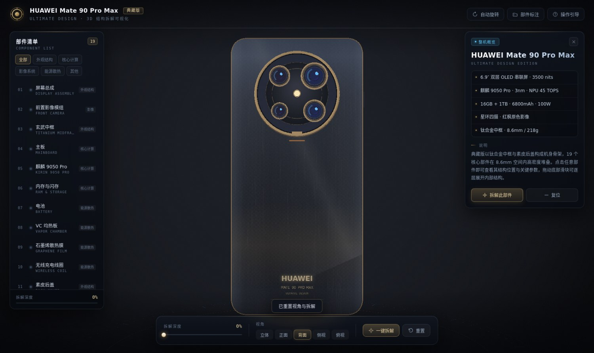
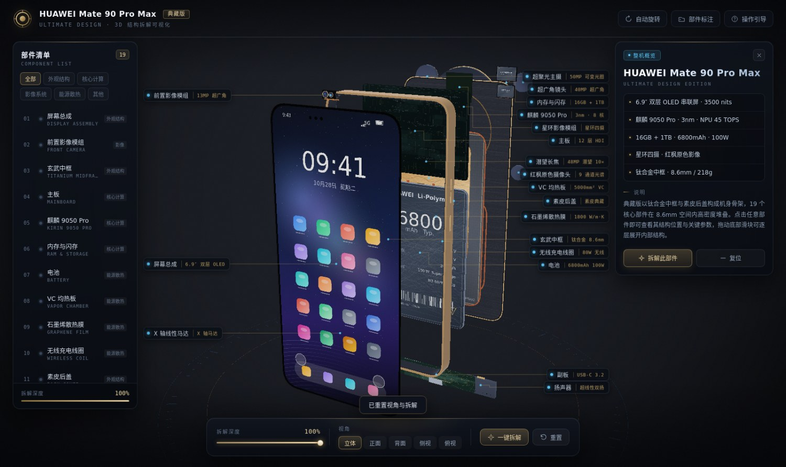
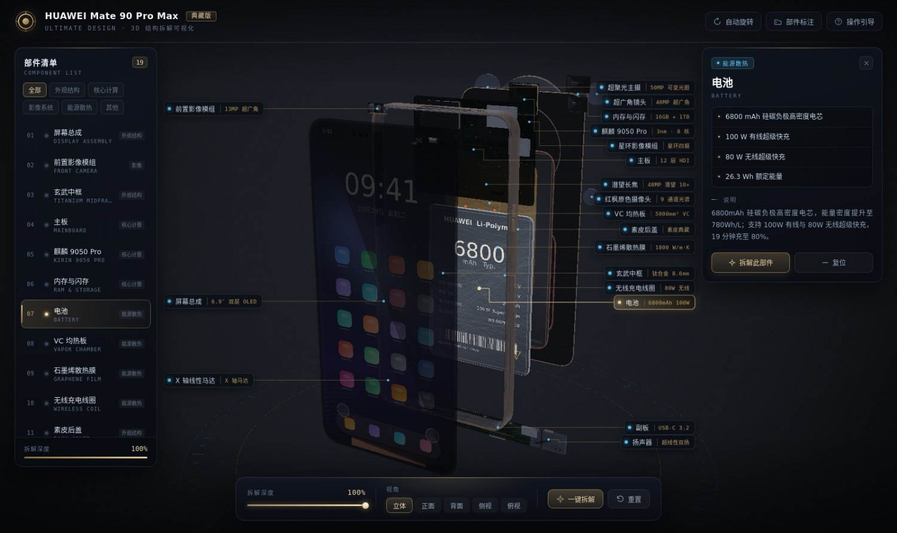
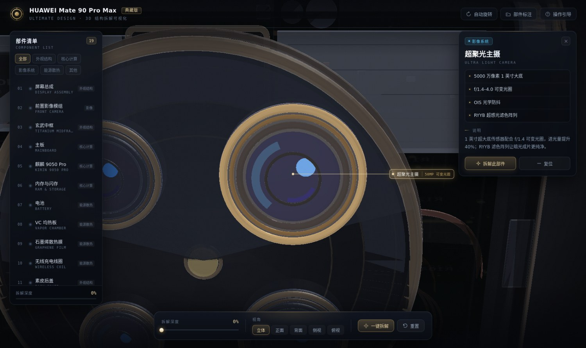
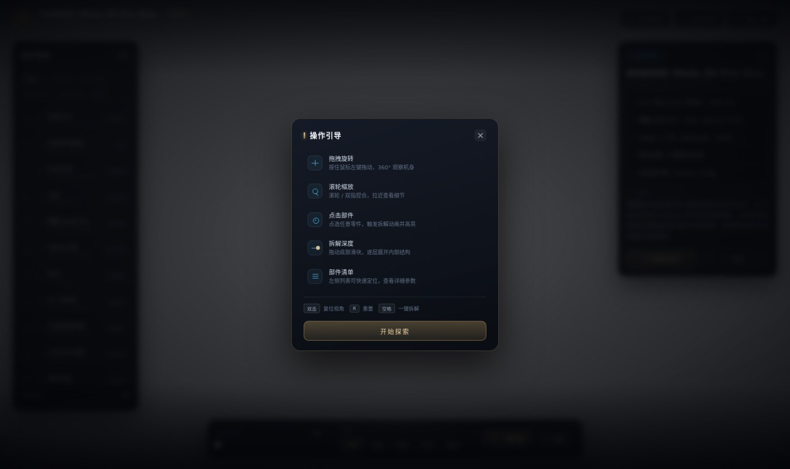
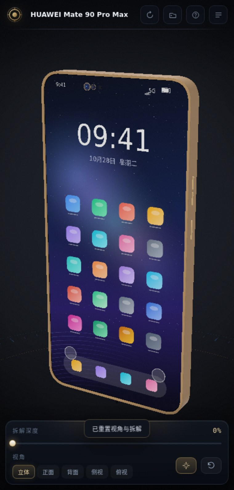
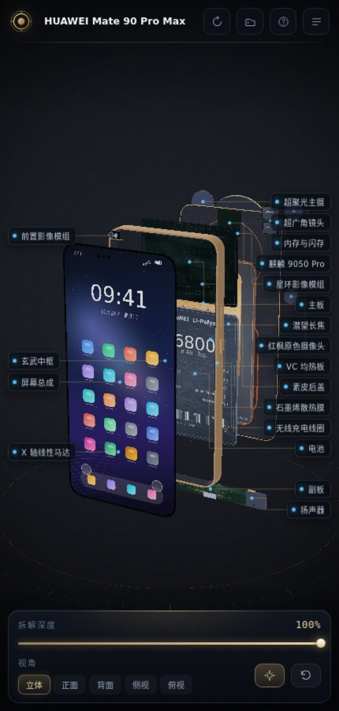

# 旗舰手机 3D 拆解可视化 · Phone 3D Teardown

一个纯前端、零外部资源的三维拆解演示：把一台虚构的「旗舰直板手机」用代码一层层建出来，点哪个零件就拆哪一层，边拆边看参数。

整个模型——机身、屏幕、星环影像模组、四颗镜筒、主板、芯片、电池、散热膜、线圈、马达、扬声器——全部由 JavaScript 程序化生成，**不加载任何 `.glb` / `.obj` / 贴图文件**。产物是一个 780 KB 的单文件 HTML，双击就能在浏览器里跑，断网也能用。

> ⚠️ 说明：本项目是一个**独立的概念设计 / 技术演示**，机型、参数、芯片型号均为虚构，用于展示 WebGL 建模与交互实现。与任何厂商无关联，也不代表任何真实产品。

---

## 效果预览

| 正面 | 后盖 |
|---|---|
|  |  |

| 19 层拆解 + 工程图标注 | 选中部件：高亮 + 前层透视 |
|---|---|
|  |  |

| 主摄特写 | 操作引导 |
|---|---|
|  |  |

| 移动端 · 整机 | 移动端 · 拆解 |
|---|---|
|  |  |

---

## 在线体验

GitHub Pages 直接打开：**https://mapeople.github.io/phone-3d-teardown/**

或本地打开仓库里的 `dist/index.html`（无需服务器、无需联网）。

---

## 交互

| 操作 | 效果 |
|---|---|
| **点击任意部件** | 该部件高亮并自动展开到 78%，其余部件压暗 |
| **拖拽** | 自由旋转视角 |
| **滚轮 / 双指** | 缩放 |
| **双击** | 复位视角 |
| **底部滑块** | 手动控制 0–100% 拆解深度 |
| **视角按钮** | 立体 / 正面 / 背面 / 侧视 / 俯视 五档预设 |
| **左侧清单** | 19 个部件，支持按分组筛选（外观结构 / 核心计算 / 影像系统 / 能源散热 / 其他） |
| **详情卡** | 显示选中部件的参数与说明，「拆解此部件」会按包围盒自动取景 |

快捷键：`空格` 一键拆解 · `R` 重置 · `L` 标注开关 · `A` 自动旋转 · `Esc` 取消选中。

### 两个值得一提的实现细节

**前层透视（ghost）**：拆解状态下，如果直接点击被屏幕挡住的电池，视觉上什么都看不到。所以选中某个部件时，会按拆解方向计算「谁挡在它前面」，把这些层做成半透明（最多 55% 透明度 + 关闭深度写入），于是隔着屏幕也能看清后面的电池。

**芯片自动翻面**：SoC 和内存的丝印贴在主板背面。点它们聚焦时，相机会自动绕到最近的那一侧，而不是傻傻地停在正面看一块空板子。

---

## 技术实现

- **Three.js r157**（UMD 全局构建，内联进单文件）
- 无构建依赖运行时：`node build.mjs` 把 `vendor/three.min.js` + 5 个源文件拼成一个 `<script>` 内联进 HTML
- 所有贴图（屏幕壁纸、后盖素皮、PCB 走线、芯片丝印、电池标签）都是运行时用 Canvas 2D 画出来的
- 环境光照用程序化 equirect 图 + `PMREMGenerator` 生成，没有 HDR 文件
- 几何：圆角矩形挤出（`ExtrudeGeometry` + bevel）、环形（`rrRing`）、球冠镜片（压扁的 `SphereGeometry` 扇面）

### 目录结构

```
├── src/
│   ├── index.html      页面骨架（顶栏 / 清单 / 详情卡 / 底栏 / 引导）
│   ├── styles.css      深色科技风视觉
│   ├── lib.js          几何与材质工具库（圆角体、环形、球冠、材质工厂）
│   ├── textures.js     全程序化 Canvas 贴图
│   ├── model.js        19 个部件的建模与拆解向量
│   └── app.js          渲染器、轨道控制、拾取、动画、标注、UI 绑定
├── vendor/three.min.js
├── build.mjs           打包成单文件
├── dist/index.html     构建产物（单文件，离线可用）
├── docs/               GitHub Pages 站点 + README 配图
└── tools/              验证与截图工具（Playwright + CPU 软件光栅化器）
```

### 构建

```bash
node build.mjs
# ✓ dist/index.html  791.4 KB  (单文件，离线可用)
```

不需要 `npm install`——`build.mjs` 只读文件、拼字符串，没有第三方依赖。

### 关于 `tools/` 里的 CPU 光栅化器

开发这个项目时，容器里的 headless Chromium **无法渲染 WebGL 三角形**（`drawArrays` 之后 `readPixels` 全 0，ANGLE 层损坏，各种 swiftshader / EGL 组合都试过）。为了在没有 GPU 的环境里验证外观，写了一个 CPU 软件光栅化器（`tools/raster.core.js`）：带 z-buffer、透视校正、贴图采样、Blinn 高光、金属菲涅尔、自发光叠加，把 Three.js 场景在 2D Canvas 上重新画一遍，再合成回页面截图。

所以 `tools/live.cjs` 之类的脚本产出的图，是 CPU 渲染的近似结果；**页面本身走的是标准 WebGL**，在真实浏览器里会有真实的环境反射、Bloom 级高光和抗锯齿，比截图更精细。

```bash
node tools/live.cjs '[{"name":"my-shot","explode":1}]' 1600 950
node tools/functest6.cjs        # 端到端交互自测
```

---

## 已验证

`tools/functest6.cjs` 端到端自测覆盖：19 部件 / 19 标注 / 19 清单项、点击清单选中并展开、聚焦取景、拆解滑块、视角预设、分组筛选、标注开关、一键拆解 toggle、键盘快捷键、3D 射线拾取、拖拽旋转、滚轮缩放、双击复位、Esc 取消选中 —— 全部通过，无 console error。

---

## License

MIT
